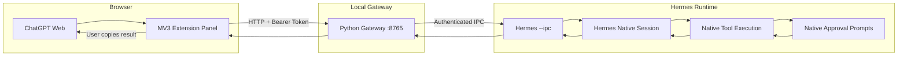

# Hermes Cognitive Bridge

**Local integration layer connecting ChatGPT Web with the Hermes AI agent CLI through a Chromium browser extension and a local Python gateway.**

[]()
[]()
[]()
[]()

---

## Overview

Hermes Cognitive Bridge reduces repetitive manual copy/paste between ChatGPT Web and the Hermes CLI while retaining full user control and Hermes' native security and approval mechanisms.

### The Problem

Users of Hermes CLI often plan and reason in ChatGPT Web, then manually copy prompts to Hermes for execution. This bridge automates the transfer step only — **it does not replace Hermes' model providers or execution environment**.

### The Architecture



**Key architectural principles:**
- **Hermes retains its own model providers** (e.g., NVIDIA NIM, others) — ChatGPT is not the model provider for Hermes
- **Native Hermes approval workflow is preserved** — the bridge exposes no approval bypass
- **User controls every transfer** — no automatic scraping or submission
- **Local-only gateway** — binds to 127.0.0.1, validates Origin headers
- **One-time pairing + bearer token** — separate trust boundaries for browser↔gateway and gateway↔Hermes IPC

---

## Development Status

> ⚠️ **This project is under active development. Interfaces, IPC behavior, and installation procedures may change. It is not currently recommended for production use.**

| Component | Status |
|-----------|--------|
| Chromium MV3 Extension | ✅ Implemented |
| Local Python Gateway | ✅ Implemented |
| One-time Pairing + Bearer Auth | ✅ Implemented |
| Request/Status/Result API | ✅ Implemented |
| Hermes Native IPC (`hermes --ipc`) | ✅ Implemented in source checkout |
| IPC Protocol (session/model metadata) | ✅ Implemented |
| Gateway Task Execution | ❌ **Disabled** (`IPC_EXECUTION_ENABLED = False`) |
| Live Browser Integration Testing | ❌ Not verified |
| Live Hermes IPC Execution | ❌ Not verified |
| Session Continuity/Switching | ❌ Not verified |
| Native Tool-Approval Preservation | ❌ Not verified end-to-end |

**Gateway task execution remains deliberately disabled.** HTTP `POST /v1/requests` returns **503** with error code `UNSAFE_EXECUTION_MODE` until the live native-approval acceptance test passes.

---

## Features

### Implemented
- **Extension panel** injected above ChatGPT composer with shadow DOM isolation
- **Three operating modes**: Manual (explicit transfer), Assisted (selection prepares prompt), Auto (one-click transfer)
- **Session selection** from live Hermes native session manager
- **Provider/model metadata** from live Hermes IPC (names only, no credentials)
- **One-time pairing code** printed by gateway on startup
- **Bearer token authentication** stored in extension local storage
- **Request recovery** after page reloads via `chrome.storage.local`
- **Result copy-to-clipboard** with explicit user action
- **Origin validation** (chrome-extension:// only) + Host header validation

### Partially Implemented
- **IPC protocol** — implemented in Hermes source checkout, verified in unit tests, not yet live-tested
- **Cancellation path** — protocol implemented, gated behind `IPC_EXECUTION_ENABLED = False`

### Planned
- Live native-approval acceptance test (critical blocker)
- Session continuity and switching validation
- Multi-session isolation and queue handling
- Automated browser smoke tests
- Production hardening (rate limiting, token rotation, revoke endpoints)

### Not Yet Verified
- Real-browser integration (extension load, pairing, panel injection)
- Live Hermes IPC connection with `hermes --ipc`
- Harmless task execution through native TUI chat path
- Native dangerous-tool approval prompt observation and denial
- Cancellation through Hermes' native interrupt mechanism

---

## Technology Stack

| Layer | Technology |
|-------|------------|
| Gateway | Python 3.10+, standard library only (http.server, threading, multiprocessing.connection) |
| Extension | JavaScript ES2020, Chrome Manifest V3, Service Worker, Shadow DOM |
| Hermes Integration | Local IPC via `multiprocessing.connection` (Windows `AF_PIPE`, Unix `AF_UNIX`) |
| Authentication | One-time pairing code + 32-byte bearer token + 32-byte IPC authkey |
| Transport | HTTP/JSON over loopback, authenticated IPC frames (1 MiB cap) |
| Dependencies | PyYAML (gateway only), zero npm dependencies |

---

## Installation

### Prerequisites
- **Python 3.10+**
- **Chromium-based browser** (Chrome, Brave, Edge) with Developer Mode
- **Hermes CLI** with the modified source checkout (see [HERMES_INSTALLATION_CHANGES.md](HERMES_INSTALLATION_CHANGES.md))

### Development Setup

> ⚠️ **Verified steps** vs. **steps requiring validation** are marked below.

#### 1. Hermes IPC (requires modified source checkout)
```powershell
# Exit any existing Hermes session normally
# Activate the modified Hermes checkout
& "C:\Users\vighn\AppData\Local\hermes\hermes-agent\activate.ps1"
# Start Hermes with IPC enabled
hermes --ipc
```
✅ **Verified:** Source changes compile, IPC tests pass in isolation  
❌ **Not verified:** Live `hermes --ipc` descriptor creation, TUI readiness

#### 2. Gateway
```powershell
cd gateway
python -m pip install -r requirements.txt
python server.py
```
✅ **Verified:** Gateway starts, prints pairing code, binds to 127.0.0.1:8765  
❌ **Not verified:** Live connection to `hermes --ipc` process

#### 3. Browser Extension
1. Open `chrome://extensions` (or `brave://extensions`)
2. Enable **Developer mode**
3. Click **Load unpacked** → select the `extension/` directory
4. Open a ChatGPT conversation (`chatgpt.com` or `chat.openai.com`)
5. Enter the pairing code from the gateway terminal in the panel

✅ **Verified:** Extension loads, passes `node --check`, Manifest V3 valid  
❌ **Not verified:** Real browser panel injection, pairing flow, metadata fetch

---

## Security

| Mechanism | Description |
|-----------|-------------|
| **Local-only gateway** | Binds to `127.0.0.1:8765` only; validates `Host` and `Origin` headers |
| **Pairing** | One-time code per gateway process; extension stores bearer token in local storage |
| **IPC authentication** | 32-byte random key in `interactive.json` descriptor; Windows ACL / Unix 0700 |
| **Approval preservation** | No approval decision method in IPC; gateway only observes native approval state |
| **No ChatGPT scraping** | Extension reads only user selection/input; never accesses cookies, tokens, or responses |
| **Execution disabled** | `IPC_EXECUTION_ENABLED = False` — gateway returns 503, never queues or launches tasks |
| **No credentials in logs** | Prompts/results not logged; IPC metadata exposes names only |

### Known Security Limitations
- No OS-protected token storage (extension local storage only)
- No explicit token revoke/rotate endpoints
- No robust rate limiting
- Do not expose gateway to LAN interfaces

See [docs/SECURITY.md](docs/SECURITY.md) for the complete threat model and security documentation.

---

## Documentation

| Document | Description |
|----------|-------------|
| [Architecture](docs/ARCHITECTURE.md) | System components, communication flow, responsibilities, security boundaries |
| [IPC Protocol](docs/IPC_PROTOCOL.md) | Implemented IPC methods, request/response structures, lifecycle |
| [Security](docs/SECURITY.md) | Threat model, authentication, pairing, origin validation, known limitations |
| [Development](docs/DEVELOPMENT.md) | Developer setup, prerequisites, testing commands, Windows specifics |
| [Roadmap](docs/ROADMAP.md) | Realistic phased milestones with current status |

---

## Roadmap

See [docs/ROADMAP.md](docs/ROADMAP.md) for detailed milestones:

- **Phase 1** — Repository and Gateway Stabilization (authentication, CORS, browser smoke tests)
- **Phase 2** — Native Hermes IPC Validation (live IPC, harmless execution, session continuity)
- **Phase 3** — Approval and Execution Validation (native approval prompts, cancellation)
- **Phase 4** — Multi-Session Support (isolation, switching, queue handling)
- **Phase 5** — Release Preparation (automated tests, security review, compatibility)

All milestones are **planned or in progress** — none are complete.

---

## Contributing

See [CONTRIBUTING.md](CONTRIBUTING.md) for:
- Development setup
- Coding conventions
- Branch and pull request expectations
- Testing requirements
- Security reporting guidance

---

## License

**This repository currently has no explicit license.** A license must be chosen before publication. The Hermes Agent itself is a separate project with its own licensing — this bridge does not relicense or claim ownership of Hermes.

---

## Repository Structure

```
hermes-cognitive-bridge/
├── gateway/
│   ├── server.py          # Local HTTP gateway (stdlib only)
│   ├── ipc_client.py      # Authenticated Hermes IPC client
│   └── requirements.txt   # PyYAML only
├── extension/
│   ├── manifest.json      # Manifest V3
│   ├── service-worker.js  # Background event handling
│   ├── content.js         # In-page panel (shadow DOM)
│   ├── popup.html         # Extension popup UI
│   ├── popup.js           # Popup logic
│   └── popup.css          # Popup styles
├── tests/
│   ├── test_security_remediation.py
│   ├── test_ipc_client.py
│   └── test_extension_contract.py
├── docs/
│   ├── ARCHITECTURE.md
│   ├── IPC_PROTOCOL.md
│   ├── SECURITY.md
│   ├── DEVELOPMENT.md
│   └── ROADMAP.md
├── .github/
│   ├── ISSUE_TEMPLATE/
│   └── workflows/
├── .gitignore
├── README.md
├── CONTRIBUTING.md
├── CHANGELOG.md
└── LICENSE (to be added)
```

---

## Quick Reference

### API Endpoints (Gateway)
| Method | Path | Auth | Status |
|--------|------|------|--------|
| GET | `/v1/health` | No | ✅ Ready |
| POST | `/v1/pair` | No | ✅ Pairing |
| GET | `/v1/providers` | Bearer | ✅ Metadata |
| GET | `/v1/sessions` | Bearer | ✅ Metadata |
| GET | `/v1/state` | Bearer | ✅ Metadata |
| POST | `/v1/requests` | Bearer | ❌ 503 Disabled |
| GET | `/v1/requests` | Bearer | ❌ Empty |
| GET | `/v1/requests/{id}` | Bearer | ❌ 404 |
| GET | `/v1/requests/{id}/result` | Bearer | ❌ 404 |
| DELETE | `/v1/requests/{id}` | Bearer | ❌ 503 Disabled |

### IPC Methods (Hermes `--ipc`)
| Method | Purpose |
|--------|---------|
| `state` | Readiness, session/provider/model, busy flag |
| `sessions.list` | Native session IDs, titles, active marker |
| `model.list` | Configured provider/model names (no credentials) |
| `submit` | Queue prompt for TUI chat processing |
| `session.create` | Alias for new-session submit |
| `request.get` | Request state and result |
| `requests.list` | Retained request records |
| `request.cancel` | Cancel queued or interrupt active |

---

*Last updated: 2026-10-31*